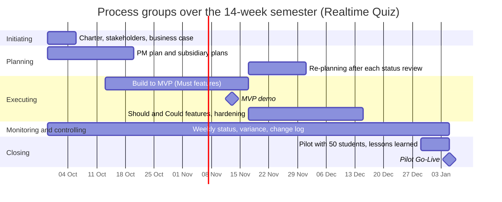

# Process Groups Mapping

| Process group              | Weeks active | Main activities                                                                     | Outputs                                                 | Lab that produces them  |
| -------------------------- | ------------ | ----------------------------------------------------------------------------------- | ------------------------------------------------------- | ----------------------- |
| Initiating                 | 1            | Define project charter, identify stakeholders, construct business case              | Project Charter, Stakeholder Register, Business Case    | Lab 01                  |
| Planning                   | 1-3, 7-8     | Develop project management plan, WBS, schedule, risk register, and re-plan post-MVP | WBS, Gantt Chart, Risk Matrix, Architecture Specs       | Labs 02, 03, 04, 07, 08 |
| Executing                  | 3-12         | Build software components, implement WebSocket, integrate features, perform CI/CD   | Source Code, Test Suites, Working Builds, MVP Demo      | Labs 05, 06, 09, 10     |
| Monitoring and controlling | 1-14         | Track progress, evaluate schedule/cost variances, review risks, manage changes      | Weekly Status Reports, Change Logs, Updated Baselines   | Labs 05, 06, 09, 11     |
| Closing                    | 13-14        | Conduct 50-student pilot, perform final acceptance, complete handoff, post-mortem   | Final Pilot Report, Operations Runbook, Lessons Learned | Lab 12                  |

## Process groups over the semester

