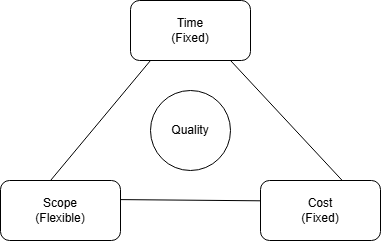

# Constraint analysis · Realtime Quiz · v0.1

| Constraint | Fixed or flexes    | Evidence (quote, source)                                                                                                                                                                   | If violated                                                                                |
| ---------- | ------------------ | ------------------------------------------------------------------------------------------------------------------------------------------------------------------------------------------ | ------------------------------------------------------------------------------------------ |
| Time       | FIXED (Driver)     | "Go-live is a pilot with 50 students in week 14" (Lab-01 recap, Milestones). The project duration is 14 weeks.                                                                             | Missing the pilot deadline means the project cannot meet its semester milestone.           |
| Cost       | FIXED              | "Cash budget: 200 USD" (Lab-01 recap, Budget).                                                                                                                                             | Exceeding the budget requires additional funding that has not been approved.               |
| Scope      | FLEXES             | "8 Must, 5 Should, 4 Could features" (Lab-01 recap, Scope). The Should features require 110 hours and Could features require 94 hours, giving 204 flexible hours out of 504 planned hours. | Should and Could features may need to be postponed or removed.                             |
| Quality    | FIXED              | "Non-functional requirements (broadcast under 500 ms, WCAG AA, CI green)" (Lab-01 recap, Quality targets).                                                                                 | The application may fail performance, accessibility, or software quality expectations.     |
| Resources  | FIXED              | "4 students × 10 h/week = 40 h/week" (Lab-01 recap, Resources).                                                                                                                            | The team cannot complete additional work without exceeding its available working capacity. |
| Risk       | FLEXIBLE (managed) | "504 h planned work + 56 h (10 %) contingency" (Lab-01 recap, Budget).                                                                                                                     | Unmanaged risks may consume contingency time and threaten the week-14 pilot.               |

## Project shape

Realtime Quiz is a fixed-date, fixed-budget project.

The driver is time because the project must deliver its pilot with 50 students in week 14, before the semester ends.

The second fixed side is cost, with a cash budget of only 200 USD, while scope absorbs surprises through the Should and Could features, representing 204 hours (approximately 40% of planned feature effort).

## Quality floor (never traded)

1. Performance: Real-time broadcast updates must be delivered in under 500 milliseconds.
2. Accessibility: The application must meet WCAG AA accessibility requirements.
3. Continuous integration: The CI pipeline must pass and remain green before the project is considered complete.

